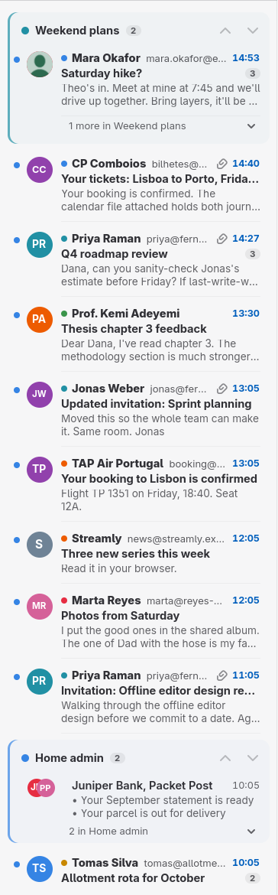
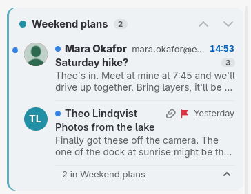
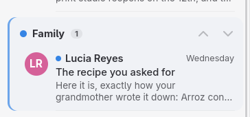
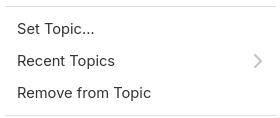
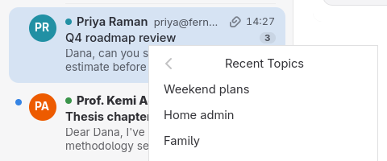
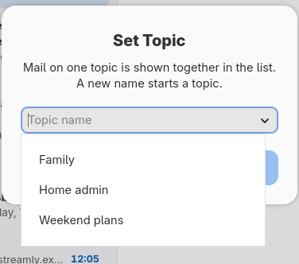
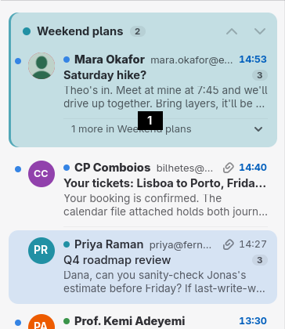
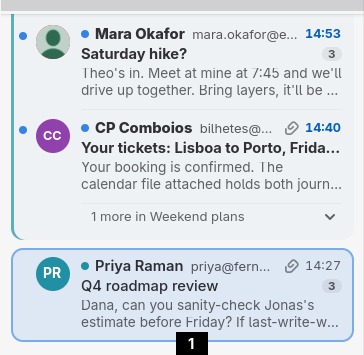

# Topics

A topic is a name you give a piece of work, such as "Q3 Launch",
"Invoices" or "Kitchen renovation". You put mail on it, and the message
list draws that mail together so you can follow the work without a
folder or a search.

## Why topics

Mail about one piece of work rarely arrives in one go. A reply comes in
on Monday, an invoice on Wednesday, a question from someone new on
Friday, and the rest of your mail lands in between. Folders take the
mail out of your inbox, so you stop seeing it arrive. Labels keep it in
place, but scattered.

A topic keeps the mail where it is, in date order, and gathers the
messages that sit near each other into a **bundle**: one block in the
list with the topic's name on top. You still read your inbox from the
top down, and the work shows as one piece.

A message is on one topic at a time. Putting it on another takes it off
the first.

## The rolling window

Bundles gather mail that is close together in the list, not every
message the topic has ever had. Walking down the list from the newest
mail:

1. The first message on a topic starts a bundle, which sits where that
   message was.
2. A later message on the same topic joins the bundle if it comes within
   **20 rows** of the last message the bundle gathered. It moves up into
   the bundle, and the rows it passed keep their order.
3. Each message that joins moves the window down with it, so a busy
   topic keeps growing one bundle for as long as its mail keeps coming.
4. A message more than 20 rows past the last one starts a new bundle of
   the same topic further down.

So a topic with steady traffic shows as one bundle, and a topic you come
back to after a quiet month shows as two: the recent mail near the top,
the older mail where it happened.

*Two bundles in the inbox. "Weekend plans" is closed and shows its
unread mail; "Home admin" is all read and shows a summary.*

The arrows on a bundle's header jump to the topic's previous and next
bundles. The down arrow loads more mail if it has to, up to ten pages,
and stops there if it finds none.

## What a bundle shows

Every bundle has a **header** with a colored dot, the topic's name, how
many conversations it holds, and the two arrows. A colored edge and a
light tint run down the side of the bundle, so you can see where it
starts and ends. Each topic always gets the same color, picked from its
name.

A **closed** bundle shows:

- its unread conversations, and a line under them counting the rest
  ("3 more in Invoices"), or
- when everything in it is read, a short summary of the senders and
  subjects it holds.

Click the header, the trailer or the summary, or press Enter on one, to
**open** the bundle. An open bundle shows every conversation in it, in
the same order as the list. Click again to close it.

A conversation you are reading stays visible when the bundle closes, so
reading a message does not make it disappear from under you once it
counts as read.

A topic with only one conversation nearby still gets a header. It never
folds, since folding would only hide that conversation, but the header
shows which topic it is on and is a place to drop more mail.

Search results are never bundled. They stay in the order the search
ranks them.

## Turning bundles off

The **Group by Topic** button, left of Search at the top of the list,
turns bundles off and on. With it off, the list shows every conversation
in date order, as if no mail were on a topic, and the mail keeps its
topics for when you turn it back on. Penguin Mail remembers the choice.
The button is grayed out over search results, which are never bundled.

## Putting mail on a topic

### From the menu

Right-click a conversation in the list, or open **More Actions** in the
header bar. The menu has three topic items:

- **Set Topic…** asks for a name. Type one and press Enter or click Set.
  The field lists the topics your accounts already know as you type; use
  the arrow at its end to see them all, Down to move into the list, and
  Enter or a click to take one. A new name starts a new topic.
- **Recent Topics** is a submenu of the five topics nearest the top of
  the list you are looking at, newest first. It is missing when the list
  shows no topics.
- **Remove from Topic** takes the mail off its topic.

 

The menu works on everything selected, so you can select several
conversations first and put them all on one topic.

### By dragging

Drag conversations from the list:

- **onto a bundle**, anywhere on its header, its conversations or its
  trailer, to put them on that topic. The whole bundle lights up in its
  color while you hover over it.
- **onto a conversation outside every bundle**, to take them off their
  topic. That conversation lights up in the accent color.

 

Dragging does not move the list. The list stays where it was while you
drag and after you drop.

### Undo

Each change shows a short notice ("Added to Invoices", "Removed from
topic") and can be undone like a label change.

## Names

- A name holds up to 64 characters. Spaces at either end are dropped,
  and runs of spaces become one.
- Names match ignoring case. "q3 launch" joins "Q3 Launch", and a name
  your accounts already know keeps the spelling it has.

## Across devices

Topics travel with the mail, so other computers running Penguin Mail see
them too:

- On **Gmail**, a topic is a label named `topic:` and the name, such as
  `topic:Q3 Launch`. Penguin Mail hides these labels from the label list
  and the sidebar. Gmail's own apps show them as ordinary labels.
- On **IMAP** servers, a topic is a keyword on the message. Penguin Mail
  writes the name in a form IMAP accepts, so "Foo bar" becomes
  `topic:=46oo=20bar`. The server has to keep keywords it has not seen
  before: most do, and Penguin Mail checks before relying on it. On a
  server that does not, topics stay on the computer that set them.

Other mail apps ignore IMAP keywords like these, so topics do not show
up in them.
